# Laboratorio 09: Generación y actualización de embeddings en Azure SQL Database

En este ejercicio, explorarás cómo integrar Azure SQL Database con Azure OpenAI para generar y actualizar *embeddings* vectoriales directamente desde la base de datos, lo que permite implementar escenarios de búsqueda semántica y aplicaciones de IA generativa (RAG).

## Requisitos previos

Antes de comenzar este laboratorio, asegúrate de contar con lo siguiente:
* Una suscripción a Azure activa.
* Permisos para crear recursos (Azure SQL Database, Azure OpenAI / AI Foundry).
* Un entorno de desarrollo local como **Visual Studio Code** con la extensión **SQL Server (mssql)** o SQL Server Management Studio (SSMS).
* Azure CLI instalado y autenticado en tu entorno.

## Aprovisionamiento de la base de datos SQL de Azure

El primer paso es crear el repositorio donde almacenaremos nuestros datos relacionales y sus correspondientes representaciones vectoriales (*embeddings*).

1. Inicia sesión en el portal de Azure.
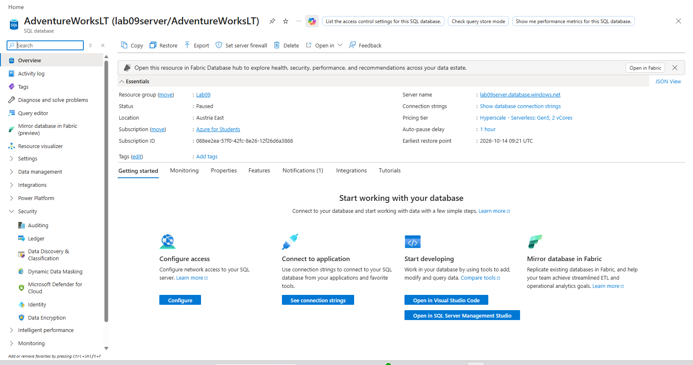
2. Navega a **SQL Databases** y selecciona **Crear**.
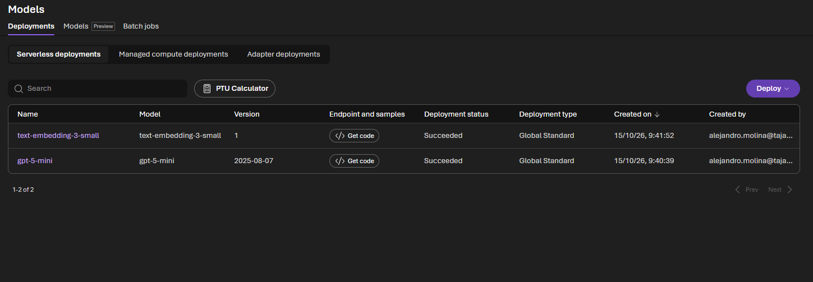
3. Configura los detalles básicos:
   * Selecciona tu suscripción y un grupo de recursos nuevo (ej. `Lab09-Embeddings-RG`).
   * Proporciona un nombre para la base de datos (ej. `VectorDB`).
   * Crea un nuevo servidor lógico de Azure SQL y configura la autenticación (se recomienda usar SQL y Microsoft Entra).
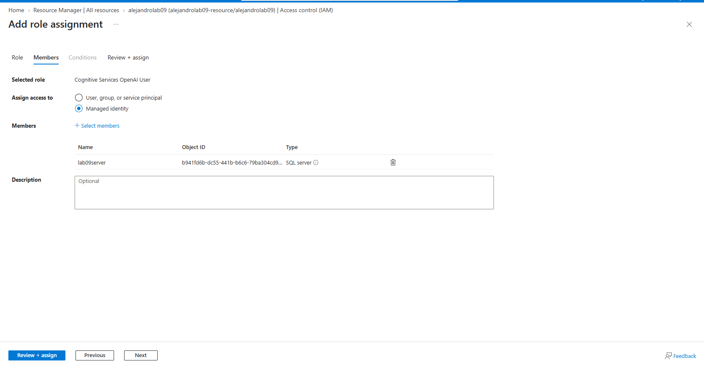
4. En la pestaña de Redes, asegúrate de **Permitir que los servicios y recursos de Azure accedan a este servidor** y añade tu dirección IP local a las reglas del firewall.
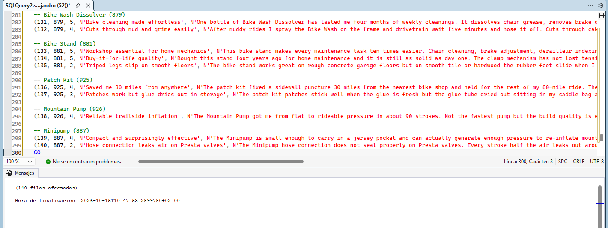
5. Revisa y crea el recurso. Una vez finalizado, conéctate a la base de datos usando Visual Studio Code.
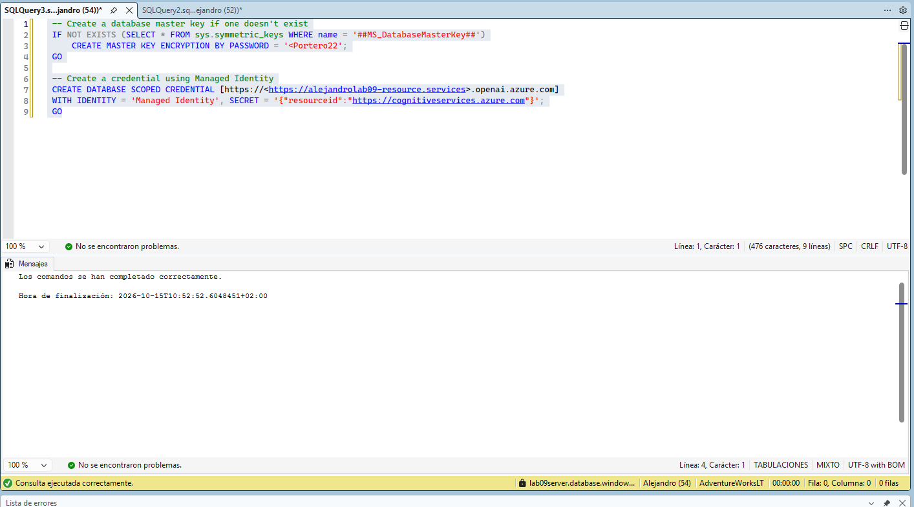
## Configuración de Microsoft Foundry e implementación de modelos de OpenAI de Azure

Para generar los *embeddings*, necesitamos un modelo de lenguaje de Azure OpenAI.

1. En el portal de Azure, busca **Azure OpenAI** y crea un nuevo recurso en la misma región que tu base de datos (si es posible).
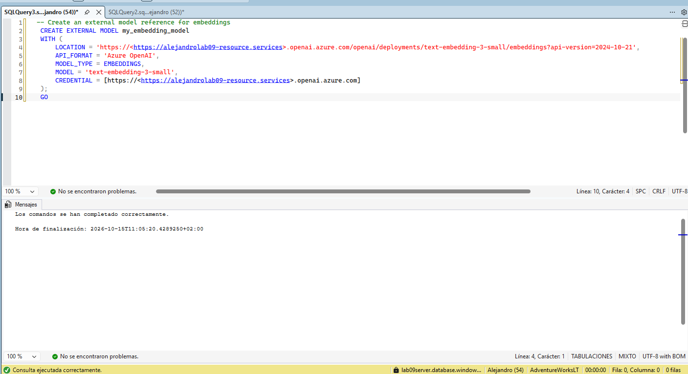
2. Una vez desplegado el recurso, accede al **Azure AI Foundry portal** (anteriormente Azure OpenAI Studio).
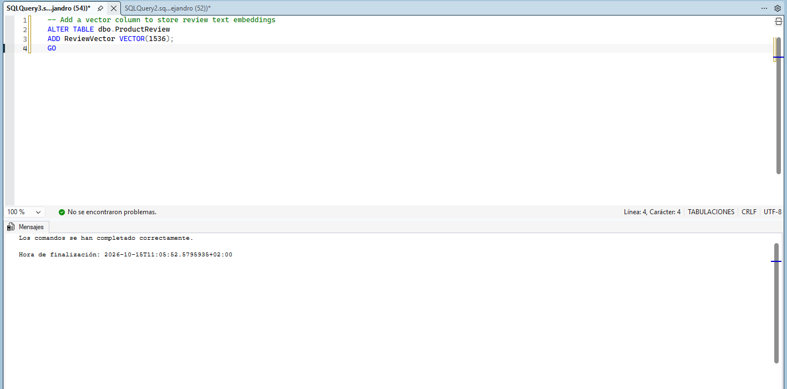
3. Dirígete a la sección de **Implementaciones** (Deployments) y crea una nueva implementación.
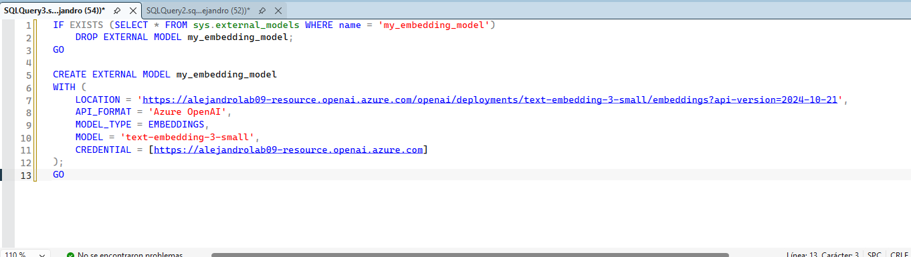
4. Selecciona un modelo de *embeddings*, por ejemplo, `text-embedding-ada-002` o `text-embedding-3-small`.
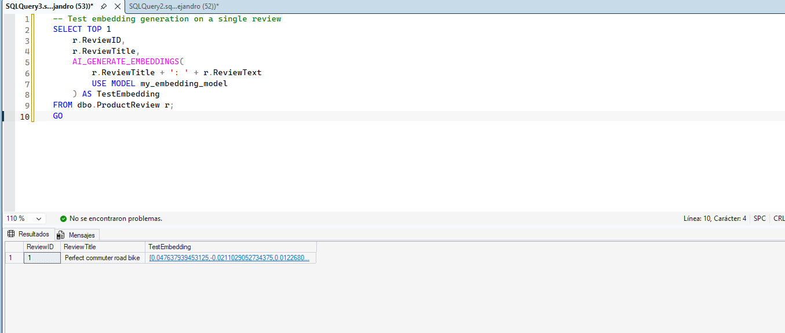
5. Asigna un nombre a la implementación (ej. `my-embedding-model`) y anota este nombre y el **Endpoint (Punto de conexión)** del recurso, ya que los necesitarás más adelante.

## Configuración del acceso a identidades administradas
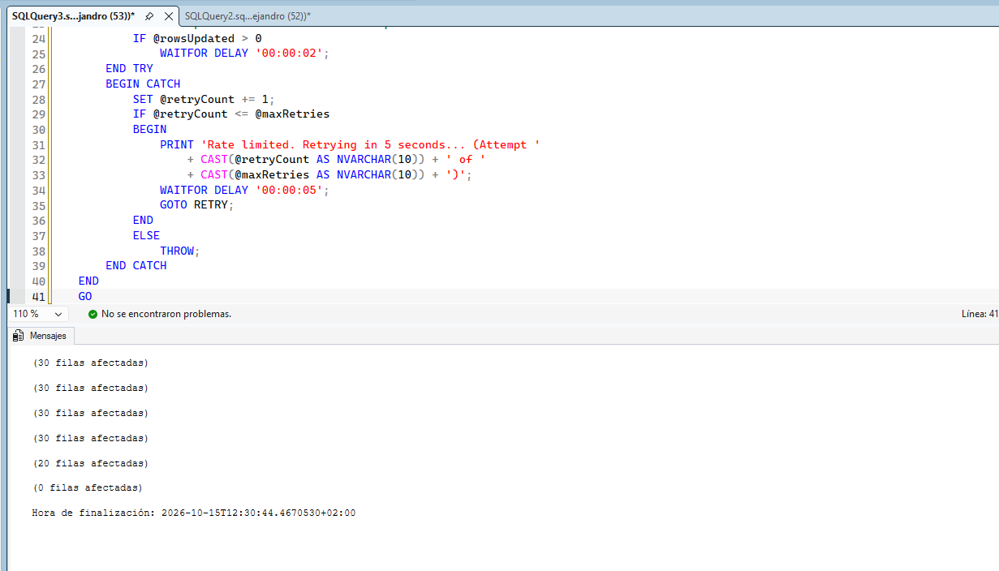
Para que Azure SQL Database pueda comunicarse de forma segura con Azure OpenAI sin almacenar claves de API en el código, configuraremos una Identidad Administrada.

1. Ve a tu Servidor de Azure SQL en el portal de Azure.
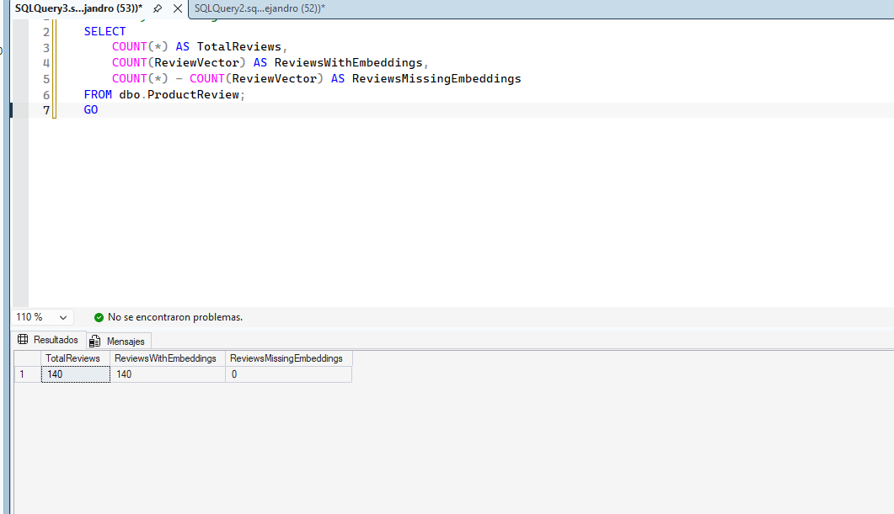
2. En el menú de la izquierda, bajo **Seguridad**, selecciona **Identidad**.
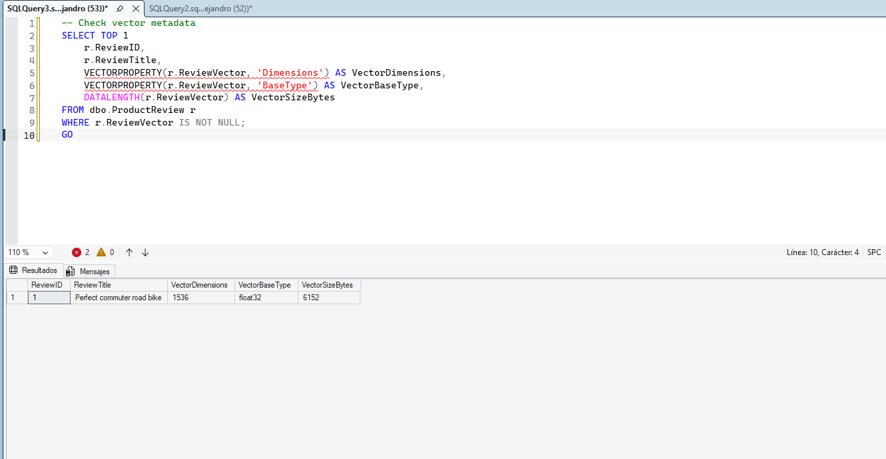
3. Habilita la **Identidad asignada por el sistema** (System assigned identity) y guarda los cambios.
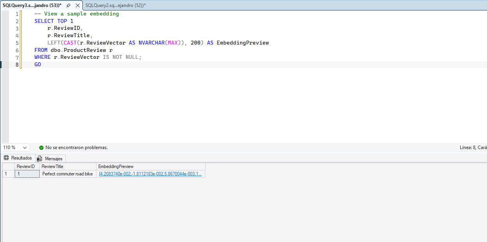
4. Ve al recurso de **Azure OpenAI** que creaste.
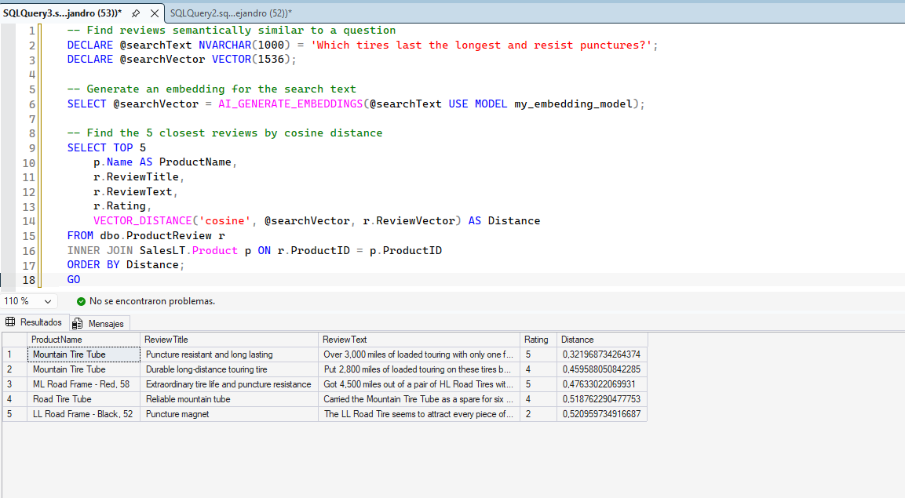
5. Accede a **Control de acceso (IAM)** y selecciona **Agregar asignación de roles**.
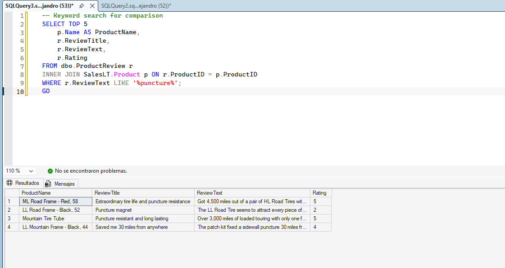
6. Asigna el rol **Cognitive Services OpenAI User** a la identidad administrada de tu servidor Azure SQL. Esto autoriza a la base de datos a invocar el modelo de OpenAI.
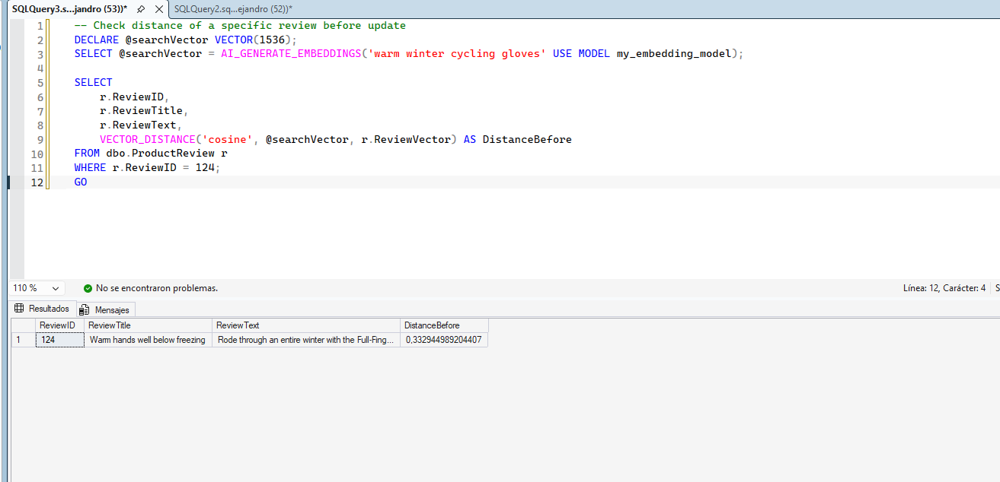
## Creación de embeddings

Ahora configuraremos la base de datos para consumir el endpoint de OpenAI y generar *embeddings* a partir de datos de texto.

1. Conéctate a tu base de datos mediante Visual Studio Code.
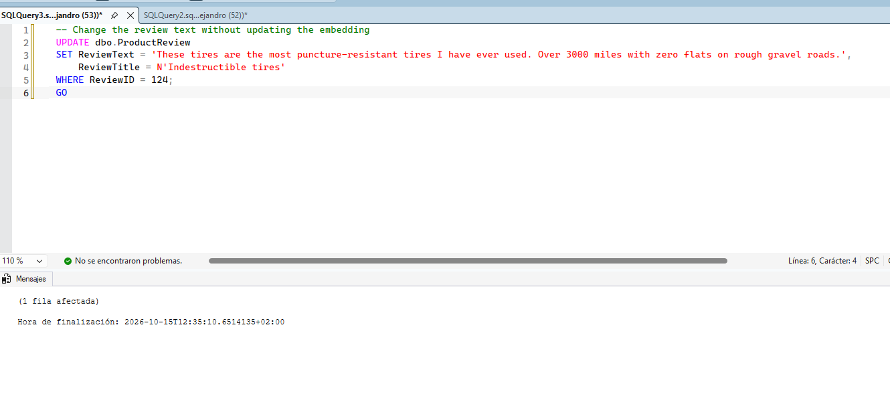
2. Crea una tabla de ejemplo para almacenar texto y sus vectores:

   ```sql
   CREATE TABLE Documentos (
       Id INT IDENTITY(1,1) PRIMARY KEY,
       Contenido NVARCHAR(MAX),
       Embedding VECTOR(1536) -- El tamaño depende del modelo usado
   );
   GO
   ```

3. Inserta algunos datos de prueba:

   ```sql
   INSERT INTO Documentos (Contenido)
   VALUES ('Azure SQL Database soporta funciones nativas de IA.'),
          ('El cielo es azul y está despejado hoy.');
   GO
   ```
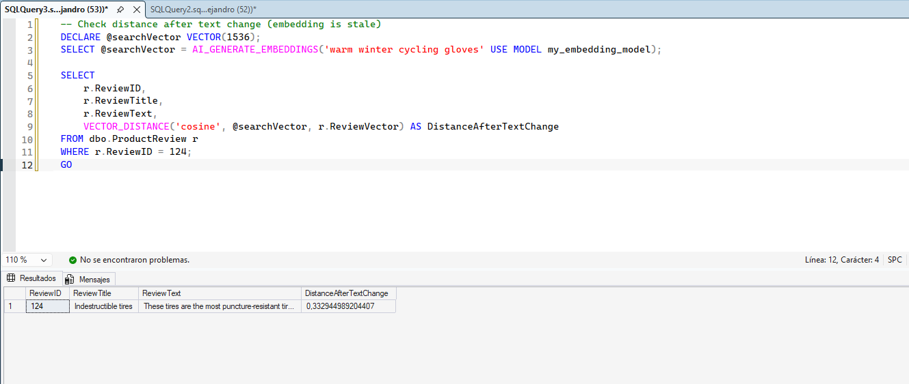
4. Utiliza el procedimiento almacenado del sistema `sp_invoke_external_rest_endpoint` para llamar a la API de OpenAI y actualizar la tabla. (Asegúrate de reemplazar `<TU_ENDPOINT_OPENAI>` y `<NOMBRE_IMPLEMENTACION>` por tus valores reales):

   ```sql
   DECLARE @url NVARCHAR(4000) = 'https://<TU_ENDPOINT_OPENAI>.openai.azure.com/openai/deployments/<NOMBRE_IMPLEMENTACION>/embeddings?api-version=2023-05-15';
   DECLARE @payload NVARCHAR(MAX) = N'{"input": "Azure SQL Database soporta funciones nativas de IA."}';
   DECLARE @response NVARCHAR(MAX);

   EXEC sp_invoke_external_rest_endpoint
       @url = @url,
       @method = 'POST',
       @credential = [https://<TU_ENDPOINT_OPENAI>.openai.azure.com],
       @payload = @payload,
       @response = @response OUTPUT;

   -- Aquí se extraería el vector de la respuesta JSON para insertarlo en la tabla
   SELECT @response;
   GO
 

   ```
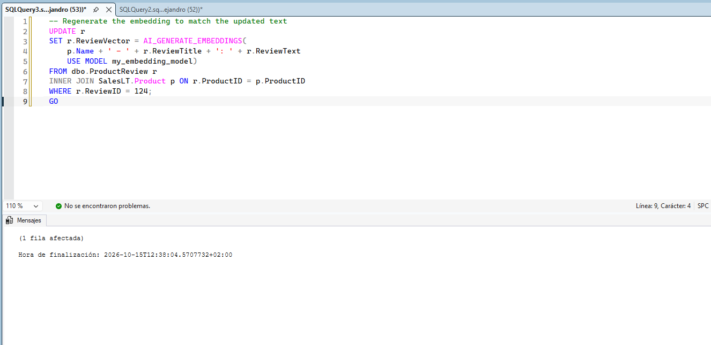
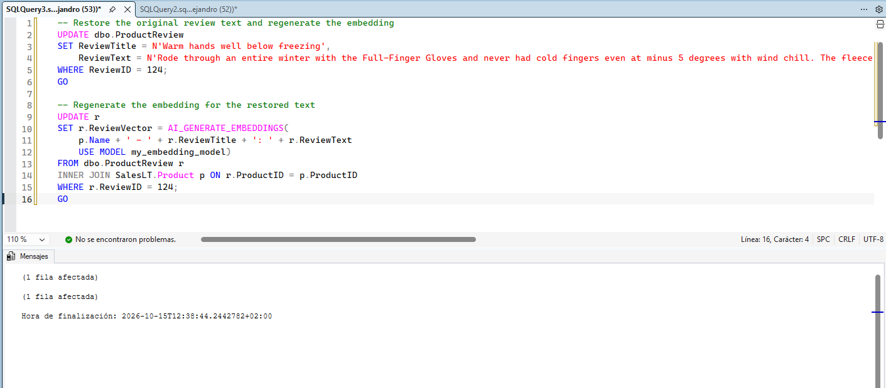
*(Nota: En un entorno de producción, este proceso se suele empaquetar en una función de tabla en línea o un procedimiento almacenado para procesar lotes de filas automáticamente).*

---
**Limpieza:** Recuerda eliminar el grupo de recursos al finalizar el laboratorio para evitar incurrir en costes innecesarios.